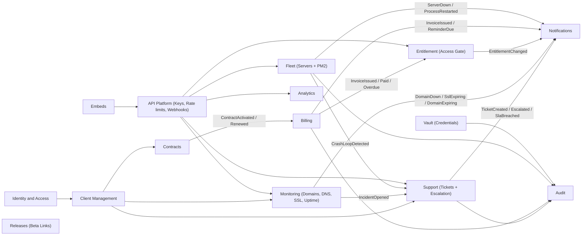
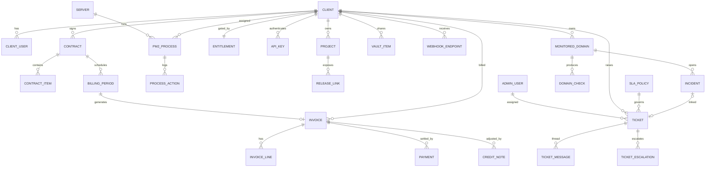
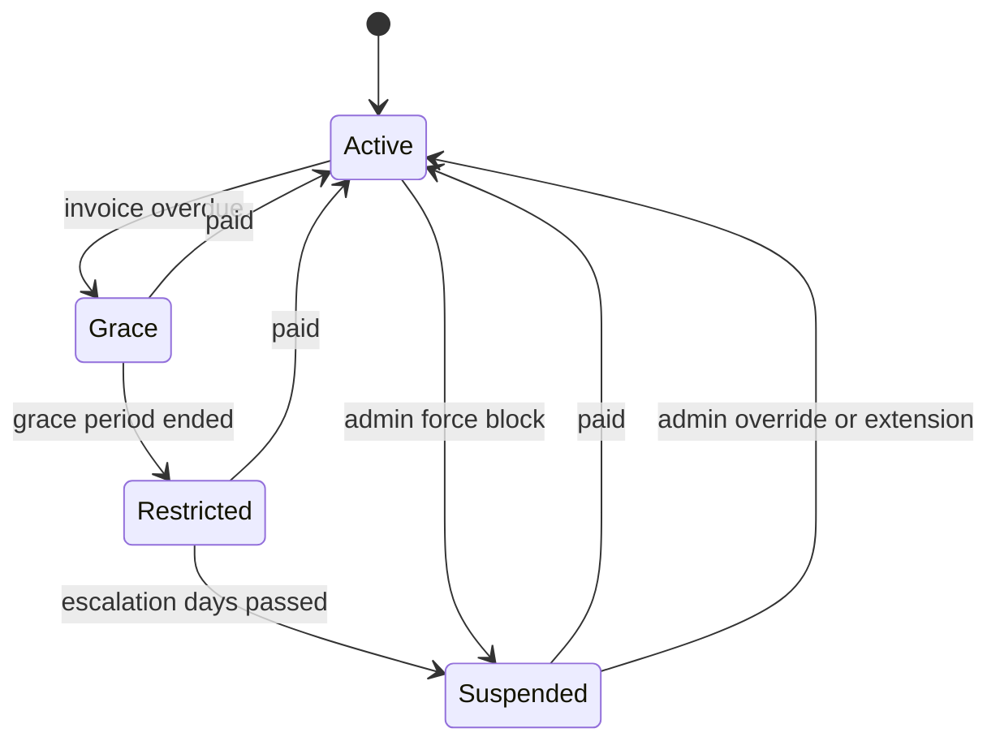
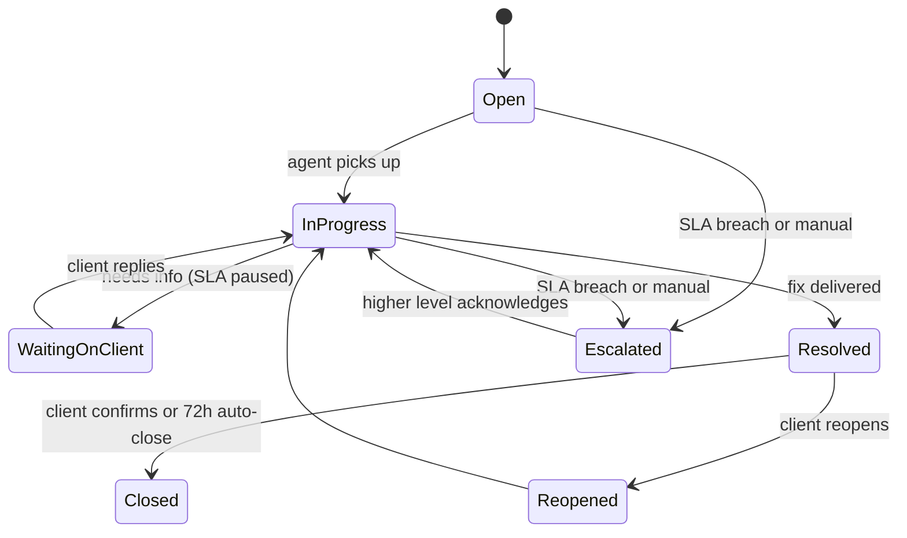
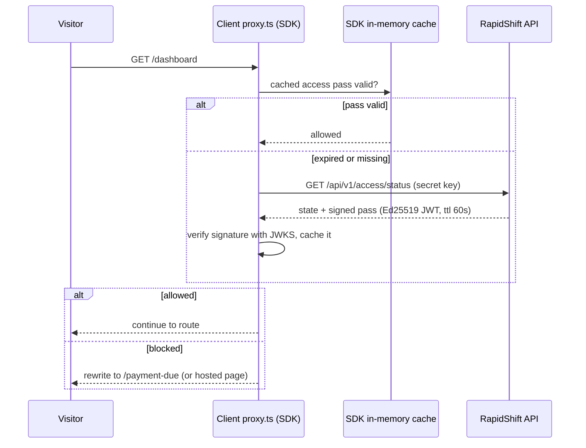

# RapidShift Control Plane: Master Plan

A **client service layer** that sits on top of every client app you deliver. It handles billing, access gating, fleet ops (Oracle servers and PM2), analytics, a credentials vault, release links, embeds, and documentation. It is built as a **Domain-Driven** monorepo on **Next.js 16 + shadcn/ui + SQLite/libSQL (WAL)**.

> [!IMPORTANT]
> The workspace `rapidshiftlabs/` is empty, so this is a greenfield build. Node `v22.13.1` and npm `11.8` were detected. Please read **§14 Open Questions** before approving. A few of the answers change the architecture.

---

## 1. Goals at a Glance

| Audience | What they get |
|---|---|
| **You (Admin/Staff)** | Clients, contracts, amounts, tenure (valid from/to), billing cycles, invoices, payments, credit notes, dunning, server/PM2 fleet, vault, releases, analytics, embed studio, audit log, revenue dashboards |
| **Clients (Portal)** | Live billing status and next-due countdown, invoices/PDFs, contract, servers/processes with metrics and **restart**, analytics, beta links, shared credentials, API keys, embed codes, docs |
| **Client apps (API/SDK)** | `/api/v1/*` REST API, an **access gate** for their `proxy.ts`/`middleware.ts`, an **analytics tracker** for the root layout, and **embeddable widgets** |
| **Your team** | Generated OpenAPI 3.1 reference with request/response schemas, examples, and guides |

---

## 2. Tech Stack

| Concern | Choice | Why |
|---|---|---|
| Framework | **Next.js 16** (App Router, Turbopack, React 19.2, Cache Components, `proxy.ts`) | Latest stable. `proxy.ts` replaces `middleware.ts` in v16 and runs on Node |
| UI | **shadcn/ui** + Tailwind v4 + lucide + shadcn Charts (Recharts) + TanStack Table + react-hook-form | Consistent design system for admin and portal |
| DB | **SQLite via `@libsql/client`** (local file mode) + **Drizzle ORM** + drizzle-kit migrations | Type-safe schema and migrations on libSQL |
| Validation / Contracts | **Zod v4** → OpenAPI 3.1 (`zod-openapi`) | One schema drives validation, TS types, docs, and SDK types |
| Auth (admin + portal users) | **NextAuth / Auth.js v5** (`next-auth@5`) + `@auth/drizzle-adapter` (libSQL), JWT sessions, custom TOTP 2FA, RBAC | Your choice. Admins sign in to `/admin`; see §5.0 |
| Realtime | **SSE** (Server-Sent Events) on an outbox-backed in-process event hub | Live tickets, billing, metrics, and domain status without a separate WebSocket server |
| Monitoring | Node `dns/promises`, `tls`, `undici` + **RDAP** (registry API) | Domain, DNS, SSL, and uptime checks with no paid APIs |
| API auth | Custom API keys (hashed) + Ed25519 signed JWTs via **`jose`** | Fast local verification for the gate and embeds |
| SSH | **`ssh2`** with a pooled persistent connection per server | No shelling out, keep-alive, channel multiplexing |
| PDFs | `@react-pdf/renderer` | Invoice and credit-note PDFs |
| Email | React Email + Resend / SMTP (nodemailer) | Invoices, reminders, alerts |
| Docs | **Fumadocs** (MDX, shadcn-native) + **Scalar** API reference | Guides plus an interactive API explorer |
| Embeds | **Preact Web Components** (Shadow DOM) + iframe fallback | ~15 KB, style-isolated, drop-in |
| Tracker | Vanilla TS, under 2 KB gzipped, `sendBeacon` | Minimal impact on client sites |
| Logging | pino (JSON), request IDs | Structured logs |
| Tests | Vitest (domain/integration) + Playwright (E2E) + autocannon (load) | |
| Monorepo | **pnpm workspaces + Turborepo** | Shared core between the portal and the worker |

---

## 3. Domain-Driven Architecture

### 3.1 Bounded Contexts (Context Map)



Contexts communicate only through **domain events** (transactional outbox) or their **public application API** (`index.ts`). Importing another context's internals is blocked by an ESLint boundary rule (`eslint-plugin-boundaries`).

### 3.2 Layering Inside Every Context

```
modules/billing/
├─ domain/            # Pure TS. No framework, no DB. Entities, Value Objects, Aggregates, Events, Repository PORTS, Domain Services
├─ application/       # Use cases: commands/ + queries/, DTOs, Zod contracts, ports (Clock, Mailer, PdfRenderer)
├─ infrastructure/    # Drizzle schema + repositories, adapters (ssh2, email, pdf), mappers
└─ index.ts           # The ONLY public surface (exports use cases + DTO types)
```

**Dependency rule:** `domain ← application ← infrastructure`. Presentation (Next.js routes/UI) calls application use cases through a **composition root** (lightweight manual DI, no heavy container).

The shared kernel lives in `packages/core/src/shared/kernel`: `Entity`, `AggregateRoot`, `ValueObject`, `DomainEvent`, `Result<T,E>`, `Id` (ULID-based, prefixed: `cli_`, `ctr_`, `inv_`…), `Money`, `DateRange`, `Clock`.

### 3.3 Monorepo Structure

```
rapidshiftlabs/
├─ apps/
│  ├─ portal/                          # Next.js 16: admin + client portal + public API + docs + iframe embeds
│  │  ├─ src/app/
│  │  │  ├─ (auth)/admin/login, admin/2fa, portal/login, invite/[token]
│  │  │  ├─ (admin)/admin/
│  │  │  │  ├─ dashboard/  clients/[clientId]/{overview,contracts,invoices,payments,projects,
│  │  │  │  │                 processes,domains,tickets,vault,releases,api-keys,analytics,users,audit}
│  │  │  │  ├─ contracts/  invoices/  payments/  fleet/servers/[id]  fleet/processes
│  │  │  │  ├─ support/{inbox,tickets/[id],sla-policies,escalation-matrix,canned-replies}
│  │  │  │  ├─ monitoring/{domains,domains/[id],incidents,status-pages}
│  │  │  │  ├─ analytics/  embeds/  audit/  settings/{company,tax,numbering,email,team}
│  │  │  ├─ (portal)/portal/
│  │  │  │  ├─ overview/  billing/{invoices,payments,contract}  infrastructure/{servers,processes}
│  │  │  │  ├─ support/{tickets,tickets/new,tickets/[id]}  domains/
│  │  │  │  ├─ analytics/  releases/  credentials/  api-keys/  embeds/  team/
│  │  │  ├─ status/[clientSlug]/        # Public status page (uptime + incidents)
│  │  │  ├─ embed/[widget]/page.tsx     # iframe embeds (real shadcn components)
│  │  │  ├─ docs/[[...slug]]/           # Fumadocs
│  │  │  ├─ api/
│  │  │  │  ├─ v1/…                     # Public client API (API key auth)
│  │  │  │  ├─ collect/                 # Analytics ingest (publishable key)
│  │  │  │  ├─ stream/                  # SSE realtime (tickets, billing, metrics, domains)
│  │  │  │  └─ auth/[...nextauth]/      # NextAuth (Auth.js v5) handlers
│  │  │  └─ .well-known/jwks.json/      # Public keys for gate/embed token verification
│  │  ├─ src/auth.ts                    # NextAuth config (providers, callbacks, RBAC claims)
│  │  ├─ src/proxy.ts                   # Next 16 proxy: protects /admin/* and /portal/* via auth()
│  │  ├─ src/features/<context>/        # Presentation per context: components, server actions, hooks
│  │  ├─ src/components/ui/             # shadcn/ui
│  │  ├─ src/lib/http/                  # route wrapper: auth, rate-limit, error envelope, request-id
│  │  ├─ src/composition-root.ts
│  │  └─ content/docs/                  # MDX guides
│  └─ worker/                          # Long-running Node process (run under PM2)
│     └─ src/jobs/{metrics-poller, invoice-generator, dunning, entitlement-recompute,
│                  outbox-dispatcher, webhook-deliverer, analytics-rollup, retention, db-maintenance,
│                  sla-escalator, uptime-checker, ssl-checker, dns-checker, rdap-expiry-checker}
├─ packages/
│  ├─ core/                            # ALL bounded contexts (framework-agnostic) + shared kernel + DB layer
│  │  └─ src/{shared, modules/{identity,clients,contracts,billing,entitlement,fleet,support,monitoring,
│  │                           analytics,vault,releases,api-platform,embeds,notifications,audit}}
│  ├─ contracts/                       # Zod API schemas → OpenAPI spec + exported TS types
│  ├─ sdk/                             # @rapidshift/sdk: API client, Next.js gate, <RslAnalytics/>, embed helpers
│  ├─ embed/                           # Web components → built to apps/portal/public/embed.js
│  ├─ tracker/                         # Analytics script → apps/portal/public/t.js
│  └─ config/                          # tsconfig, eslint (with boundary rules), tailwind preset
├─ data/                               # core.db, analytics.db, metrics.db (gitignored)
└─ turbo.json, pnpm-workspace.yaml
```

---

## 4. Database Layer: SQLite + libSQL, WAL, Concurrency Strategy

### 4.1 Three Physical Databases (Write Isolation)

| File | Contents | Primary writer | Write pattern |
|---|---|---|---|
| `core.db` | Clients, contracts, billing, entitlement, fleet config, **tickets**, **monitored domains + incidents**, vault, keys, auth, outbox, audit | Portal (user actions) + worker (scheduled jobs) | Low volume, transactional |
| `analytics.db` | Raw events + hourly/daily rollups | Portal ingest (batched) + worker rollups | High volume, append-only |
| `metrics.db` | Server/process time-series, **uptime/DNS/SSL check results**, downsampled rollups | **Worker only** | Periodic batch |

Splitting the files means a burst of analytics traffic can **never** block a payment being recorded. SQLite allows one writer per file, so three files give three independent writers.

### 4.2 Connection and PRAGMA Strategy

```
PRAGMA journal_mode = WAL;          -- persistent; readers never block writers
PRAGMA synchronous = NORMAL;        -- safe with WAL, much faster than FULL
PRAGMA busy_timeout = 5000;         -- wait instead of failing with SQLITE_BUSY
PRAGMA foreign_keys = ON;
PRAGMA temp_store = MEMORY;
PRAGMA cache_size = -64000;         -- ~64 MB page cache
PRAGMA mmap_size = 268435456;       -- 256 MB memory-mapped reads
PRAGMA wal_autocheckpoint = 1000;
```

**Tactics:**
1. **`globalThis` singleton clients** per DB, so Next.js HMR or multiple route modules never open duplicate handles.
2. A **connection factory applies the per-connection PRAGMAs** (`busy_timeout`, `synchronous`, `foreign_keys`) to every connection libSQL opens, including transaction connections.
3. **In-process write queue (async mutex) per DB.** All writes in a process are serialized in-app, so they never pile up on SQLite's lock. Reads bypass the queue and run concurrently under WAL.
4. **`BEGIN IMMEDIATE`** (`transaction("write")`) for every write transaction. The lock is taken up front, which removes the deferred-to-write upgrade deadlock behind most `SQLITE_BUSY` errors.
5. **Short transactions only.** No network or SSH I/O inside a transaction. Do I/O first, then commit. This is enforced in the Unit of Work.
6. **Batched ingest.** Analytics events are buffered in memory and flushed every 2 s or 500 events as one multi-row insert inside one transaction (1 fsync instead of 500).
7. **Cross-process safety.** Portal and worker share files through WAL plus `busy_timeout` plus per-DB *write ownership* (see table), which keeps cross-process contention minimal.
8. **Maintenance job.** `PRAGMA wal_checkpoint(TRUNCATE)` runs during quiet periods, `PRAGMA optimize` runs hourly, and incremental vacuum runs on the analytics/metrics files after retention pruning.
9. **Hot-path caching.** The gate and API-key lookup use an in-memory LRU with event-driven invalidation (see §6).
10. **Storage conventions.** Money is stored as **integer minor units** (paise), times as **UTC epoch ms integers**, IDs as prefixed ULIDs (time-sortable, index-friendly). Covering indexes back every list/filter query.
11. `@libsql/client` goes in `serverExternalPackages`, and every DB route runs in the Node runtime.

### 4.3 Core Data Model (simplified)



**Key tables:** `clients` (legal name, GSTIN, address, currency, timezone, status), `contracts` (code, status `draft|active|expired|terminated`, amount, currency, `billing_interval_unit/count`, `anchor_day`, `valid_from`, `valid_to`, `auto_renew`, `grace_days`, `payment_terms_days`, `late_fee_policy`, `tax_profile`), `billing_periods`, `invoices` (FY-series number, `draft|issued|partially_paid|paid|overdue|void`, subtotal/tax/total/paid/balance), `payments`, `credit_notes`, `entitlements` (materialized gate state + manual override), `api_keys` (prefix + hash, scopes, origins), `servers` (encrypted key, pinned host fingerprint), `pm2_processes` (pm2 id/name, client mapping, restart permission, cooldown), `process_actions`, `release_links`, `vault_items`, `webhook_endpoints/deliveries`, `outbox`, `audit_log`.
**Auth (NextAuth):** `admin_users` (role, password hash, `totp_secret_enc`, `session_version`), `client_users`, `accounts`, `verification_tokens`.
**Support:** `tickets` (number `TKT-000123`, client, project, category, priority `P1–P4`, status, level `L1–L3`, assignee, `first_response_due_at`, `resolution_due_at`, `sla_paused_at`), `ticket_messages` (public/internal, attachments), `ticket_escalations`, `ticket_events` (timeline), `sla_policies`, `escalation_matrix`, `canned_replies`.
**Monitoring:** `monitored_domains` (hostname, client, project, check config, current status fields), `domain_snapshots` (latest DNS/SSL/RDAP results), `incidents`, `status_pages`. Raw check samples go in `metrics.db.domain_checks`.

---

## 5. Domain Deep-Dives

### 5.0 Identity and Access: NextAuth (Auth.js v5)

- **One `auth.ts`** exporting `{ handlers, auth, signIn, signOut }`, mounted at `/api/auth/[...nextauth]`, with the Drizzle adapter on `core.db`.
- **Admins** sign in to `/admin/login` with the **Credentials provider** (email + Argon2id password), then a **TOTP 2FA step** (custom; enforced for every admin). Google OAuth restricted to your email allowlist can be added as an option.
- **Session:** JWT strategy (required by Credentials). Claims are `{ sub, realm: 'admin' | 'client', role, clientId?, sv }`. `sv` (session version) is checked against a cached DB value, so **sign-out-everywhere and instant revocation** still work with JWTs.
- **Route protection in layers:**
  1. `proxy.ts`: `auth()` guards `/admin/*` (realm `admin`) and `/portal/*` (realm `client`).
  2. Layout-level `auth()` re-check (defence in depth, because proxy alone is not a security boundary).
  3. A **use-case-level policy check** (`can(actor, 'invoice:create')`) inside the application layer, so Server Actions can't bypass it.
- **Admin roles:** `owner | finance | ops | support` (+ escalation levels L1/L2/L3 for support staff).
- **Client portal users:** handled by the same NextAuth instance under a separate realm (email magic link + optional password). See open question 1.

> [!NOTE]
> Auth.js is now maintained by the Better Auth team, but v5 continues to receive security fixes and fully supports Next.js 16. All auth access goes through an `identity` context port (`AuthGateway`), so the provider could be swapped later without touching other contexts.

### 5.1 Contracts and Billing

- **Contract aggregate:** amount, currency, tenure (`DateRange` valid_from to valid_to), billing cycle VO (`monthly | quarterly | half-yearly | yearly | every N days | one-time | milestone`), anchor day, payment terms (net-N), grace days, tax profile, auto-renew, line items (e.g., hosting + maintenance + AMC).
- **Lifecycle:** `Draft → Active → (Renewed | Expired | Terminated)`. Activating a contract emits `ContractActivated`, and Billing then builds the **billing schedule** (all periods within the tenure, with proration for partial first/last periods).
- **Invoice aggregate:** auto-generated by the worker N days before each period (configurable) or created manually. Includes GST (CGST/SGST/IGST by place of supply), SAC codes, FY-based numbering (`RSL/2026-27/0001`), PDF, email delivery, `void`/credit note rules. Issued invoices are immutable.
- **Payments:** manual record (UPI/bank/cash/cheque) with partial-payment support. Optional gateway (Razorpay/Stripe) payment links with webhook auto-reconciliation.
- **Dunning policy:** reminders at T-7, T-3, T-0, T+3 and so on, with configurable escalation to `Restricted`/`Suspended`.
- **Realtime:** outstanding balance, next due date, and countdown are pushed over **SSE** (`/api/stream`) whenever billing events fire.

### 5.2 Entitlement (Access Gate)



- The state is **materialized** in the `entitlements` table and recomputed on billing events and by a worker tick at every due/grace boundary. A gate request is therefore **one PK lookup served from LRU cache**, with sub-millisecond targets.
- **Admin overrides:** force-allow until a date (promised payment), force-block, maintenance mode (shows a maintenance page through the same gate).

### 5.3 Fleet: Oracle Servers + PM2

- **Server registration:** host, port, user, private key (+ passphrase), and **host key fingerprint pinning**. The "Test connection" button runs a probe and auto-discovers processes via `pm2 jlist`.
- **Processes:** discovered PM2 apps are assigned to a client/project/environment, with `allow_client_restart`, a cooldown (e.g., 60 s), and allowed actions (`restart | reload | logs`).
- **SSH layer:** one pooled persistent `ssh2` connection per server with keep-alive, exponential-backoff reconnect, and a max concurrent channel count.
- **Security (critical):**
  - **Command allowlist only.** Commands come from fixed templates (`pm2 jlist`, `pm2 restart <int>`, `pm2 logs <int> --nostream --lines <int>`, a metrics probe). Arguments are validated as integers. No string interpolation and no arbitrary shell.
  - A client can only act on PM2 IDs mapped to *their* client. Every action requires an `Idempotency-Key`, is rate-limited and cooldown-protected, and is written to the audit log.
  - Private keys are encrypted at rest with **AES-256-GCM envelope encryption** (master key in env, key versioning for rotation).
  - Recommended: a dedicated low-privilege `rsl-agent` SSH user on each server that owns PM2 (or a restricted sudoers entry).
- **Metrics poller (worker, every 30 s):** one combined probe per server (`/proc/loadavg`, `/proc/stat`, `/proc/meminfo`, `df`, `/proc/uptime`, `/proc/net/dev`) plus `pm2 jlist` for per-process status, CPU, memory, restarts, and uptime. Samples are written to `metrics.db`, downsampled raw → 5 min → 1 h, with retention of 7 d / 90 d / 2 y.
- **Health:** server-down and crash-loop detection (restart count delta), plus alerts.

### 5.4 Analytics

- **Install:** `<RslAnalytics publishableKey="rpk_live_…" />` in the client's root layout (or a `<script src=".../t.js">` tag).
- **Captures:** page views (including SPA navigations), sessions, unique visitors (**cookieless**, using a daily-rotating salted hash), referrers, UTM tags, device/browser/OS, country, **Core Web Vitals** (LCP, INP, CLS, FCP, TTFB), JS errors, outbound clicks, custom events (`rsl.track('signup', {...})`), and time on page.
- **Pipeline:** `sendBeacon` → `/api/collect` (origin-checked publishable key, bot filtering) → in-memory batch → `analytics.db` raw → worker builds **hourly/daily rollups**. Dashboards query rollups for speed. Raw data is kept for 90 days by default.
- The same data powers your admin view, the client portal, the API, and the embeds.

### 5.5 Vault, Releases, API Platform

- **Vault:** credentials (DB, SMTP, admin panels, env files) are encrypted with AES-256-GCM. Clients see metadata and must explicitly **Reveal**, which is logged with user/IP/time. Optional one-time-view and expiry.
- **Releases:** beta/staging/prod links per project with version, status, release notes, and an optional password/expiry.
- **API keys:** `rsk_live_…` (secret, server-only) and `rpk_live_…` (publishable, browser, origin-allowlisted). Only a **SHA-256 hash** plus the prefix is stored. Keys support scopes, expiry, rotation, last-used tracking, and an optional IP allowlist.
- **Webhooks to clients:** `invoice.issued`, `invoice.paid`, `entitlement.changed`, `process.restarted`, `server.down`, `ticket.updated`, `ticket.escalated`, `domain.down`, `domain.recovered`, `ssl.expiring`, `domain.expiring`. Deliveries are HMAC-signed and retried with backoff from the outbox.

### 5.6 Support: Tickets, Escalation, Realtime

**Ticket aggregate** with number, client, project, category (`bug | outage | change-request | billing | access | question`), priority (`P1 critical` to `P4 low`), level (`L1 → L2 → L3/Owner`), assignee, watchers, and links to a process/server/domain/invoice.



- **SLA policies** per contract tier and priority. Example: P1 first response 15 min / resolve 4 h; P4 24 h / 5 days. Optional business-hours calendar (IST, holidays). The SLA clock **pauses** in `WaitingOnClient`.
- **Escalation, three ways:**
  1. **Automatic:** the worker `sla-escalator` checks every minute. At 75% of SLA it sends a warning; at breach it raises the level by one (L1 → L2 → L3), reassigns per the **escalation matrix**, and notifies.
  2. **Manual by staff:** "Escalate" with a reason, choosing the level or person.
  3. **Client-initiated:** an "Escalate" button (enabled after a configurable wait, rate-limited, reason required). It bumps priority/level and pings the owner.
- **Auto-created tickets:** a domain-down incident, server down, or PM2 crash loop opens a **system ticket** linked to the incident, and resolves it automatically when the incident recovers.
- **Thread:** public replies plus **internal notes** (never sent to the client), Markdown, attachments (local disk, with size/type limits and signed download URLs), canned replies, and a full timeline (status/priority/assignee/escalation events).
- **Realtime:** every ticket change emits a domain event, which goes to the outbox and then the **SSE hub**:
  - Live thread updates, status/priority/SLA countdown changes, and assignment changes on both admin and client screens.
  - **Typing indicators and presence** ("Rahul is viewing"), sent as ephemeral events that are not persisted.
  - An admin **live inbox** with unread badges and toast notifications, plus email/Telegram for offline users.
- **CSAT** rating on close, and **reports**: SLA compliance %, median first response, escalations per client, backlog by priority.
- **Embeds:** `<rsl-ticket-widget>` (raise + list tickets) and `<rsl-ticket-thread>`.

### 5.7 Monitoring: Domain, DNS, SSL, Uptime Status

Each client domain/URL gets a **MonitoredDomain** aggregate. Worker jobs run these checks using only Node built-ins and free public protocols:

| Check | How | Frequency | Detects |
|---|---|---|---|
| **HTTP uptime** | `undici` request from the worker: status code, response time, redirect chain, optional keyword match | 1 min (configurable) | Down, slow, 5xx, wrong content |
| **SSL certificate** | `tls.connect` with SNI: issuer, validity dates, SANs, chain validity, TLS version | 6 h | Expiring (30/14/7/1 days), expired, hostname mismatch, invalid chain |
| **DNS** | `dns/promises`: A/AAAA/CNAME/MX/NS/TXT, compared with an expected baseline | 15 min | Resolution failure, **record drift** (e.g., A record changed unexpectedly), missing MX |
| **Domain registration** | **RDAP** (the official WHOIS successor, via the IANA bootstrap registry) | Daily | Expiry date (alerts at 60/30/7 days), registrar, status flags (`clientHold`, `serverHold`), nameserver changes |
| **Server correlation** | Matches the domain's resolved IP to a Fleet server | On change | "Domain down, and server X is also down" root-cause hints |

- **False-positive protection:** a domain is only marked down after **N consecutive failures** (default 3), retried from a second network path (e.g., a second Oracle server running a light probe agent, optional).
- **Incidents:** opened automatically on confirmed downtime, closed on recovery, with duration tracking, auto-linked system tickets, and alerts by email/Telegram/webhook.
- **Uptime %:** 24 h / 7 d / 30 d / 90 d, computed from rollups in `metrics.db`, plus a response-time chart.
- **Public status page** at `/status/[clientSlug]` (optional custom domain via CNAME), showing components, uptime bars, an incident history, and scheduled maintenance.
- **Embeds:** `<rsl-domain-status>`, `<rsl-uptime-badge>`, `<rsl-ssl-expiry>`, `<rsl-status-page>`.


---

## 6. The Gate: How It Works in a Client App



```ts
// client-app/proxy.ts  (Next 16; middleware.ts also supported for older versions)
import { createGate } from '@rapidshift/sdk/next';

export default createGate({
  secretKey: process.env.RSL_SECRET_KEY!,
  blockedPage: '/payment-due',        // or 'hosted'
  exclude: ['/payment-due', '/api/health'],
  failMode: 'open',                   // behaviour if RapidShift is unreachable
});
export const config = { matcher: ['/((?!_next/static|_next/image|favicon.ico).*)'] };
```

The client calls the API **at most once per TTL per instance**, not once per request. The signed pass means the client never trusts an unsigned response, and stale-while-revalidate keeps navigation instant.

---

## 7. Public API v1 (catalog)

Conventions: `/api/v1`, bearer auth, JSON envelope `{ data, meta }` / `{ error: { code, message, details, requestId } }`, cursor pagination, `Idempotency-Key` on mutations, rate-limit headers, ETags, ISO dates plus minor-unit money `{ amount, currency, formatted }`.

| Area | Endpoints |
|---|---|
| Account | `GET /me` |
| Gate | `GET /access/status`, `GET /.well-known/jwks.json` |
| Billing | `GET /billing/summary`, `GET /billing/invoices`, `GET /billing/invoices/:id`, `GET /billing/invoices/:id/pdf`, `GET /billing/payments`, `GET /contracts`, `GET /contracts/:id` |
| Fleet | `GET /servers`, `GET /servers/:id`, `GET /servers/:id/metrics?range=`, `GET /processes`, `GET /processes/:id`, `GET /processes/:id/metrics`, `GET /processes/:id/logs?lines=`, `POST /processes/:id/restart`, `GET /actions/:id` |
| Analytics | `POST /collect`, `GET /analytics/overview`, `/timeseries`, `/pages`, `/referrers`, `/devices`, `/geo`, `/vitals`, `/events`, `/errors` |
| Releases | `GET /releases` |
| Vault | `GET /credentials`, `POST /credentials/:id/reveal` |
| Embeds | `POST /embed-tokens` (mint a scoped short-lived token server-side) |
| Support | `GET /tickets`, `POST /tickets`, `GET /tickets/:id`, `PATCH /tickets/:id` (reopen/close/priority), `GET/POST /tickets/:id/messages`, `POST /tickets/:id/escalate`, `POST /tickets/:id/attachments`, `POST /tickets/:id/csat` |
| Monitoring | `GET /domains`, `GET /domains/:id` (DNS + SSL + RDAP snapshot), `GET /domains/:id/uptime?range=`, `GET /domains/:id/checks`, `GET /incidents`, `GET /incidents/:id`, `GET /status` (aggregated status-page data) |
| Realtime | `GET /stream?topics=billing,tickets,ticket:{id},processes,domains` (SSE with `Last-Event-ID` resume) |
| Webhooks | `GET/POST/DELETE /webhooks`, `POST /webhooks/:id/test` |

The admin side uses **Server Actions** plus internal route handlers that call the same application use cases.

---

## 8. Embeds

**Two delivery modes, one widget catalog:**

```html
<!-- Web Component mode (style-isolated via Shadow DOM) -->
<script src="https://portal.rapidshiftlabs.com/embed.js" async></script>
<rsl-billing-summary token="emb_…" theme="dark" accent="#6366f1"></rsl-billing-summary>

<!-- iframe mode (zero JS on client side) -->
<iframe src="https://portal.rapidshiftlabs.com/embed/billing-summary?token=emb_…" ...></iframe>
```

**Widgets:** `due-banner`, `billing-summary`, `next-due-countdown`, `invoice-list`, `invoice-detail`, `payment-history`, `contract-card`, `server-status`, `process-list`, `process-card` (with restart if the token has that scope), `metrics-chart`, `uptime-badge`, `domain-status`, `ssl-expiry`, `ticket-widget`, `ticket-thread` (live), `analytics-overview`, `analytics-chart`, `top-pages`, `web-vitals`, `releases-list`, `status-page`, plus a **full-page `<rsl-client-dashboard>`**.

**Tokens:** read-only, non-sensitive widgets can use a publishable key plus origin allowlist. Sensitive widgets (invoices, restart, credentials) need an `emb_` token minted by the client backend (scoped, 15-min TTL, auto-refresh hook).

**Embed Studio:** every card in the admin and portal has a **"</> Embed"** button that opens a live preview with theme controls and copy-ready HTML, React, and iframe snippets.

---

## 9. Documentation

- **`/docs`** (Fumadocs, inside the portal). Sections: Quickstart, Authentication and keys, the Gate, Analytics install, Embeds, Webhooks (with signature verification), SDK reference, Error codes, Rate limits, Changelog, and **internal team guides** (architecture, DDD rules, adding a context, DB conventions, runbooks).
- **API Reference:** the OpenAPI 3.1 spec is **generated from the Zod contracts** in `packages/contracts`, so the docs cannot drift from the code. Rendered with Scalar, with request/response schemas, field descriptions, examples, error responses, and curl/TS/fetch snippets.
- `openapi.json` is published so the team can import it into Postman or Insomnia.

---

## 10. Security and Reliability Checklist

- NextAuth (Auth.js v5) with Argon2id passwords, **mandatory TOTP 2FA for admins**, revocable JWT sessions (session version), login rate limiting and lockout. Role-based access: `owner | finance | ops | support` (admin) and `client_admin | client_member` (client).
- Monitoring probes have **SSRF guards**: block private/internal IP ranges, cap redirects, and set timeouts.
- Hashed API keys, scoped permissions, per-key rate limits (token bucket), origin checks for publishable keys.
- AES-256-GCM envelope encryption for SSH keys and vault items, with key rotation support.
- SSH command allowlist, host-key pinning, cooldowns, and idempotency.
- **Transactional outbox** for every domain event, so emails, webhooks, and SSE are never lost or sent twice.
- An immutable audit log of every admin and client mutation.
- CSP, secure headers, CSRF protection (Server Actions), input validation everywhere (Zod).
- Automated SQLite backups (`VACUUM INTO` snapshots, encrypted, rotated) with an optional off-site copy to Oracle Object Storage.

---

## 11. Suggested Extras (your "what more can be done")

| Category | Feature |
|---|---|
| **Revenue** | MRR/ARR dashboard, AR aging (0-30/31-60/60+), cash-flow forecast, churn, revenue per client |
| **Profitability** | Track Oracle/server/domain costs per client, giving **profit per client** |
| **Billing+** | Quotes/proposals that convert to a contract, proforma invoices, advance credit wallet, discounts/coupons, late fees, usage-based line items, UPI QR on invoices, Tally/Zoho/CSV export |
| **Contracts+** | E-sign, document attachments (SOW, NDA), renewal reminders, auto-renew, price-escalation clauses |
| **Monitoring+** | Multi-region probes, Lighthouse/performance audits on a schedule, broken-link scanner, email deliverability checks (SPF/DKIM/DMARC) |
| **Ops** | Allowlisted deploy action (`git pull && pm2 reload`), live log tail over SSE, scheduled maintenance windows (shown through the gate) |
| **Alerts** | Email, Telegram, WhatsApp, Slack for server down, crash loop, high CPU, payment received, overdue, ticket escalated |
| **Support+** | Knowledge base/FAQ per client, email-to-ticket ingestion, on-call rotation schedule for escalations |
| **Control** | Per-client feature flags/kill switches delivered through the same gate pass, "View as client" impersonation |
| **Health** | Client health score (payment punctuality + uptime + ticket volume + engagement) |

---

## 12. Delivery Roadmap (phased, each phase shippable)

| Phase | Scope | Outcome |
|---|---|---|
| **0. Foundation** | Monorepo, pnpm/Turbo, shared kernel, DB layer (3 DBs, PRAGMAs, write queue, UoW, outbox), Drizzle migrations, **NextAuth admin login + TOTP 2FA**, `proxy.ts` guards, shadcn shell (admin + portal layouts, theming), SSE hub, ESLint boundaries, CI scripts | Running skeleton with secure admin login |
| **1. Clients & Contracts** | Client CRUD, contacts, projects, users/invites, contract builder wizard, tenure, cycles, schedule preview | Admin can onboard clients |
| **2. Billing** | Billing schedule, invoice generation (auto + manual), GST, numbering, PDF, email, payments, credit notes, dunning, admin revenue dashboard | End-to-end invoicing |
| **3. Entitlement + API Platform** | Entitlement state machine, overrides, API keys, rate limiting, `/v1` billing + gate endpoints, JWKS, **SDK v1 (gate)** | Client apps can be gated |
| **4. Fleet** | Server registry, encrypted private keys, SSH pool, discovery, process mapping, worker metrics poller, restart/logs, alerts | Clients restart and monitor |
| **5. Domain Monitoring** | MonitoredDomain, uptime/SSL/DNS/RDAP checkers, incidents, uptime rollups, public status page | Domain health visible and alerting |
| **6. Support & Escalation** | Tickets, SLA policies, escalation matrix, auto-escalator, internal notes, attachments, realtime thread/presence, live inbox, system tickets from incidents | Realtime support desk |
| **7. Client Portal** | Portal overview, billing, infra, domains, tickets, releases, vault, keys, team, SSE realtime | Full client self-service |
| **8. Analytics** | Tracker, ingest, batching, rollups, dashboards, API, `<RslAnalytics/>` | Analytics live |
| **9. Embeds** | Web components, iframe routes, embed tokens, Embed Studio | No-code embedding |
| **10. Docs & Hardening** | Fumadocs guides, generated OpenAPI + Scalar, webhooks, backups, load tests, E2E suite, deployment runbook | Production-ready |

Extras from §11 are scheduled after Phase 10, or slotted in earlier on request.

---

## 13. Verification Plan

- **Domain unit tests (Vitest):** billing-cycle and proration math, FY numbering, GST calculation, entitlement state transitions, Money VO, contract tenure rules, **SLA clock (pause/resume, business hours), escalation rules, ticket state machine, incident open/close with consecutive-failure threshold**.
- **Integration tests:** repositories against temporary SQLite files, outbox dispatch, concurrency test (N parallel writers across portal and worker processes, asserting zero `SQLITE_BUSY` failures), NextAuth login + 2FA + revocation flow.
- **Monitoring checkers:** tested against `expired.badssl.com` / `wrong.host.badssl.com` (SSL cases), RDAP lookups for real domains, and a local HTTP server that toggles up/down.
- **Load tests (autocannon):** `/v1/access/status` targeting **p99 under 5 ms** (cached); `/collect` targeting **over 2k events/s** sustained on a single node; 500 concurrent SSE connections.
- **SSH adapter:** tested against a Docker container running sshd + PM2, then against one real Oracle server.
- **E2E (Playwright):** admin login with 2FA → create client → contract → invoice → mark overdue → gate blocks a demo client app → record payment → gate allows; client restarts a process; client raises a ticket and the admin sees it **live** in a second browser; an SLA breach auto-escalates; an embed renders on a static HTML page.
- **Demo client app** in `apps/demo-client` that exercises the SDK gate, analytics, and embeds end to end.

---


## 14. Locked Decisions (approved 2026-10-10)

| # | Topic | Decision |
|---|---|---|
| 1 | Client login | Clients sign in with their own credentials on a **separate URL/host** (`app.` host, `/portal/login` locally). This is a separate NextAuth credentials provider and realm, and the two session cookies are isolated. |
| 2 | Admin login | **Email + password only** (Argon2id), on the `admin.` host (`/admin/login` locally). No OAuth. |
| 3 | Hosting | A single Oracle Cloud Ubuntu VM: Nginx + Let's Encrypt in front, with `portal` and `worker` run under PM2. |
| 4 | Tooling | **pnpm workspaces + Turborepo**, plus a full **deployment guide** (`docs/DEPLOYMENT.md`). |
| 5 | ORM | **Drizzle ORM** on `@libsql/client`: thin, prepared statements, no runtime overhead. |
| 6 | Payments | **Manual payment records only** (UPI, bank transfer, cash, cheque, other). |
| 7 | GST | Settings hold the firm's legal name, GSTIN, PAN, state, address, and **bank details** (account, IFSC, bank, branch, UPI ID). **If GST is configured**, each client and contract has a `billing_mode = gst \| non_gst`. GST invoices are tax invoices with CGST+SGST (same state) or IGST (inter-state). Non-GST invoices carry no tax. The two modes use **separate numbering series**. |
| 8 | Gate fail mode | **Fail-open.** If RapidShift is down, client sites stay accessible. The SDK and embeds show a **realtime RapidShift status** indicator (`/api/v1/status` + SSE) on client dashboards. |
| 9 | Client fleet actions | **Restart + log viewing only.** |
| 10 | SSH user | `ubuntu` on every server (default value, still editable per server). |
| 11 | Support | **24×7** SLA clock and **3 escalation levels** (L1, L2, L3 = owner). |
| 12 | Alerts | **Email only** for now. The channel abstraction stays ready for more later. |
| 13 | Hosts | One Next.js app serves three hosts, routed by host in `proxy.ts`: `admin.rapidshiftlabs.com` (admin), `app.rapidshiftlabs.com` (client portal), `api.rapidshiftlabs.com` (`/v1`, `embed.js`, `t.js`, collect, status). Without host env vars it falls back to path-based routing (dev). |
| 14 | Email | **Nodemailer + Gmail SMTP.** Credentials (user + app password, encrypted) are managed in **Settings → Email** (stored in the DB) with a "send test" button. |
| 15 | Analytics | Cookieless; **raw retention 60 days** (rollups kept). **Analytics offloading:** the client connects their own HTTPS endpoint (HMAC-signed batched push), and can also use the pull export API (`GET /v1/analytics/export`, NDJSON cursor). The portal provides a step-by-step guide and a "send test batch" button. |
| 16 | Scope | **Execute all phases.** |

> [!NOTE]
> Small structural simplification: API Zod contracts live inside each context's `application/` layer in `packages/core` (no separate `packages/contracts`). The OpenAPI spec is generated from them.
